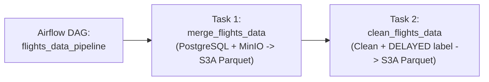

# Airflow Data Pipeline for Flights ML Project

Automated Apache Spark batch data pipeline orchestrating data extraction from PostgreSQL, enrichment from MinIO object storage, data cleaning, and feature preparation for machine learning.

## Repository Structure

```text
dag-airflow/
├── dags/
│   └── flights_pipeline_dag.py     # Airflow DAG definition
├── scripts/
│   ├── merge_data.py               # Step 1: Reads Postgres + MinIO CSVs, writes s3a://flights-data/flights
│   └── clean_data.py               # Step 2: Cleans columns, calculates DELAYED label, writes s3a://flights-data/flights-clean
├── spark_util.py                   # Modernized PySpark 3.5 / Java 17 / MinIO S3A utility
├── .gitignore
└── README.md
```

## How the Pipeline Works



1. **`merge_flights_data`**:
   - Queries `flights` table from PostgreSQL (`pg-flights-data:5432`).
   - Reads `airlines.csv` and `airports.csv` from MinIO (`airport-data` bucket).
   - Broadcast joins lookup attributes (airlines, cities, lat/long).
   - Writes Parquet files to `s3a://flights-data/flights`.

2. **`clean_flights_data`**:
   - Reads `s3a://flights-data/flights/*.parquet`.
   - Identifies and drops zero-variance (constant) columns.
   - Computes target label `DELAYED = 1` if `departure_delay >= 15` and `cancelled == 0`.
   - Writes final clean training dataset to `s3a://flights-data/flights-clean`.

## Pushing to GitHub

To sync this to your Airflow cluster:

```bash
git init
git add .
git commit -m "Add modern Spark flights data pipeline DAG"
git branch -M main
git remote add origin https://github.com/JacobItopa/dag-airflow.git
git push -u origin main
```

Airflow's `git-sync` sidecar will automatically pull this DAG within 30-60 seconds into the Airflow UI at `http://airflow.[MINIKUBE-IP].nip.io`.
